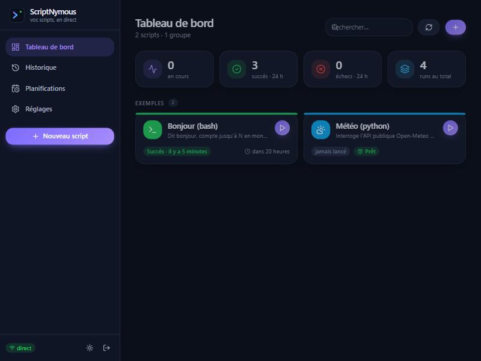

# ScriptNymous

Déclarer ses scripts, les lancer à la main ou sur planification, suivre leur sortie en direct, conserver les journaux,
être prévenu par ntfy. Un seul conteneur, une interface soignée, installable sur téléphone (PWA).

Remplaçant personnel de script-server, dans la lignée de BambuNymous.



## Fonctionnalités

- **Scripts déclarés en YAML** dans un partage (`/scripts/<slug>/script.yaml` + fichier), groupes, icône, couleur ;
  création et édition depuis l'interface (formulaire complet + éditeur de code + YAML brut), réécrits dans le partage.
- **Paramètres typés** : texte, nombre, booléen, choix, multi-choix, fichier téléversé, secret masqué ; passés en argument
  positionnel, en option `--nom valeur` ou en variable d'environnement.
- **Lancement** manuel (formulaire généré), planifié, par API (jeton), avec **sortie en direct** (websocket) et journaux
  conservés dans `/data/logs`, purgés par ancienneté et par taille.
- **Planification poussée** : cron, fuseau par script, décalage aléatoire, fenêtre horaire, jours exclus, rattrapage d'une
  occurrence manquée pendant un arrêt, aperçu des 5 prochaines dates.
- **Robustesse** : politique si une instance tourne encore (`skip`, `queue`, `kill`, `parallel`), retries exponentiels par
  code de sortie, délai maximum (SIGTERM puis SIGKILL), rapprochement avec `/proc` au démarrage, balayage des processus
  fantômes, file d'attente persistante.
- **Socle d'outils inclus** : bash, python3, node, uv, curl, wget, jq, git, rsync, ssh, ffmpeg, imagemagick, exiftool, sqlite3,
  7zip/zip, mediainfo, rclone, smbclient, outils réseau.
- **Dépendances sans reconstruire l'image** : `apt` (à chaud), `pip` (venv `uv` par script), `npm`, binaires téléchargés ;
  suggestions automatiques d'après le code et les journaux d'échec (`No module named 'PIL'` → `pillow`), ajout en un clic.
- **Variables partagées** : un fichier JSON du partage (`config.json` par défaut, choisi dans Réglages) édité en arbre
  avec filtre, ajout à toute profondeur, secrets masqués, JSON brut, sauvegarde `.bak` ; chemin passé aux scripts dans
  `SN_CONFIG_FILE`.
- **Mini-app par script** : tables SQLite déclarées dans le YAML (base propre à chaque script), dossier de fichiers,
  onglet « Suivi » généré (statuts, groupes, vignettes) ou sous-app HTML fournie par le script. Voir [docs/app.md](docs/app.md).
- **Panneau Activité** : installations d'environnement en cours avec leur journal, runs en cours, file d'attente et retries à venir.
- **Notifications ntfy** par événement (début, succès, échec, échec définitif, instance déjà en cours, script introuvable,
  processus perdu), priorité, étiquettes, lien vers le run.
- **Interface** Vue 3 + Tailwind : thème sombre et clair, mobile, PWA, tableau de bord par groupe, page de run,
  historique filtrable, planifications, réglages.
- **Serveur MCP intégré** (`/api/mcp`) : un assistant (Claude Code, Claude Desktop…) peut lister, lire, créer, modifier et
  lancer les scripts, suivre les runs, gérer planifications, variables et réglages. Voir [docs/mcp.md](docs/mcp.md).
- **Un seul utilisateur** : mot de passe par variable d'environnement (haché en base), session cookie, jeton d'API.

## Installation (Docker / Portainer)

1. Copier `.env.example` vers `docker/.env` et renseigner au moins `SN_PASSWORD` (et `SN_PUBLIC_URL`, `SN_NTFY_*`).
2. Dans `docker/docker-compose.yml`, remplacer `/mnt/nas/scripts` par le point de montage du partage NAS (ou activer le
   volume CIFS commenté).
3. Construire et lancer :

```bash
docker compose -f docker/docker-compose.yml up -d --build
```

4. Ouvrir `http://<hôte>:8080`, se connecter avec `SN_PASSWORD`. Derrière Nginx Proxy Manager : créer un proxy host vers
   le port 8080 en activant **Websockets Support** ; renseigner `SN_PUBLIC_URL` avec l'URL HTTPS pour que les liens des
   notifications fonctionnent et que la PWA soit installable.

### Volumes

| Chemin     | Contenu                                                                 |
| ---------- | ----------------------------------------------------------------------- |
| `/scripts` | partage NAS : un dossier par script (`script.yaml` + fichier du script)  |
| `/data`    | local : `scriptnymous.db`, `logs/`, `envs/`, `bin/`, `apt-cache/`, `uploads/` |

Si `/scripts` est absent ou vide au démarrage, les scripts connus passent en « introuvable », leurs planifications sont
suspendues et une notification part. Rien n'est supprimé ; tout se réarme au retour du partage.

### Variables d'environnement

Voir [`.env.example`](.env.example) : `SN_PASSWORD`, `SN_RESET_PASSWORD`, `SN_PORT`, `SN_SCRIPTS_DIR`, `SN_DATA_DIR`,
`TZ`, `SN_PUBLIC_URL`, `SN_NTFY_SERVER`, `SN_NTFY_TOPIC`, `SN_NTFY_TOKEN`, `SN_LOG_RETENTION_DAYS`, `SN_LOG_MAX_MB`,
`PUID`, `PGID`, `SN_LOG_LEVEL`. Les réglages ntfy, purge, fuseau et URL publique sont aussi modifiables depuis la page
Réglages (la valeur en base l'emporte sur la variable).

## Déclarer un script

```
/scripts/hello-bash/
├── script.yaml
└── hello.sh
```

```yaml
name: Bonjour (bash)
group: Exemples
interpreter: bash
file: hello.sh
params:
  - { name: prenom, label: Prénom, default: monde, required: true }
  - { name: compte, type: number, default: 5, pass: option }
concurrency: skip
retry: { attempts: 2, delay_seconds: 15 }
schedules:
  - { id: matin, cron: "0 8 * * 1-5", timezone: Europe/Paris, jitter_seconds: 60, catch_up: true }
notify: { events: [failure, final_failure, missing] }
```

Format complet, passage des paramètres, politiques et dépendances : [docs/format-script.md](docs/format-script.md).
Deux exemples prêts à copier dans `/scripts` : [`examples/hello-bash`](examples/hello-bash) (bash, paramètres,
planification) et [`examples/hello-python`](examples/hello-python) (python, dépendance pip).

## API

REST sous `/api`, websocket `/api/ws`, santé `/healthz`. Jeton d'API généré dans Réglages :

```bash
curl -X POST https://scripts.exemple.fr/api/scripts/hello-bash/run \
  -H "Authorization: Bearer sn_xxx" -H "Content-Type: application/json" \
  -d '{"params": {"prenom": "api"}}'
```

Détail des routes : [docs/api.md](docs/api.md). Serveur MCP pour les assistants : [docs/mcp.md](docs/mcp.md).

## Développement

Prérequis : Node ≥ 22.13 (le module intégré `node:sqlite` est utilisé, aucune compilation native).

```bash
npm install
mkdir -p scripts-local && cp -r examples/* scripts-local/   # dossier de scripts local (ignoré par git)
npm run dev        # serveur sur :8080 (mot de passe « dev »), interface Vite sur :5173
npm test           # tests du serveur (vitest)
npm run build      # interface puis serveur
npm start          # sert l'interface compilée depuis le serveur
```

En dev, `SN_SCRIPTS_DIR=../scripts-local` et `SN_DATA_DIR=../data` (voir `server/package.json`).

## Documentation

- [docs/cadrage.md](docs/cadrage.md) : objectifs, périmètre, architecture.
- [docs/decisions.md](docs/decisions.md) : choix techniques et leurs raisons.
- [docs/format-script.md](docs/format-script.md) : format `script.yaml`.
- [docs/api.md](docs/api.md) : API REST et websocket.
- [docs/app.md](docs/app.md) : mini-app par script (tables, fichiers, onglet Suivi, sous-app).
- [docs/mcp.md](docs/mcp.md) : serveur MCP (outils exposés, connexion depuis Claude Code / Claude Desktop).

## Licence

MIT.
